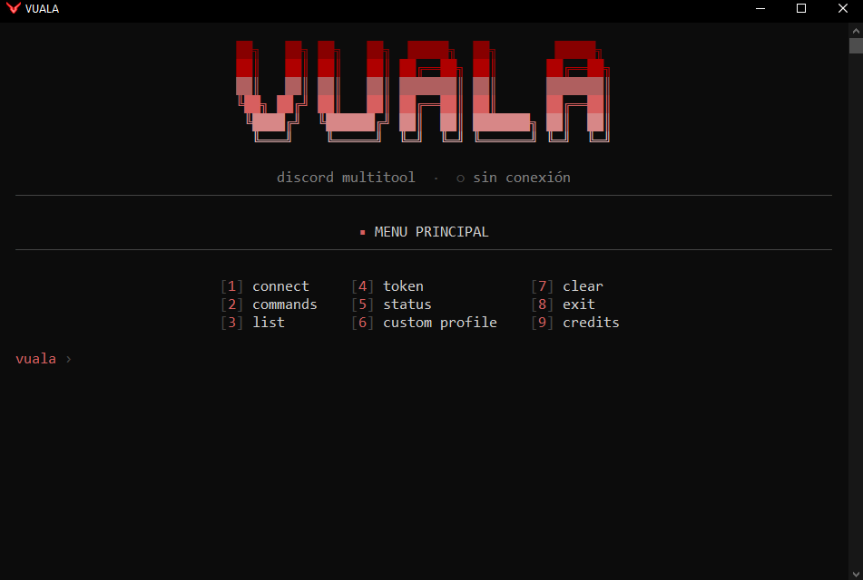
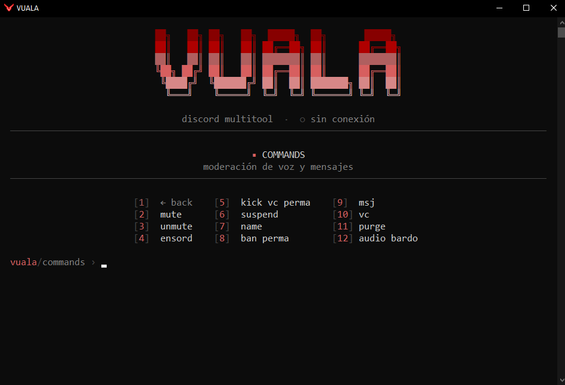
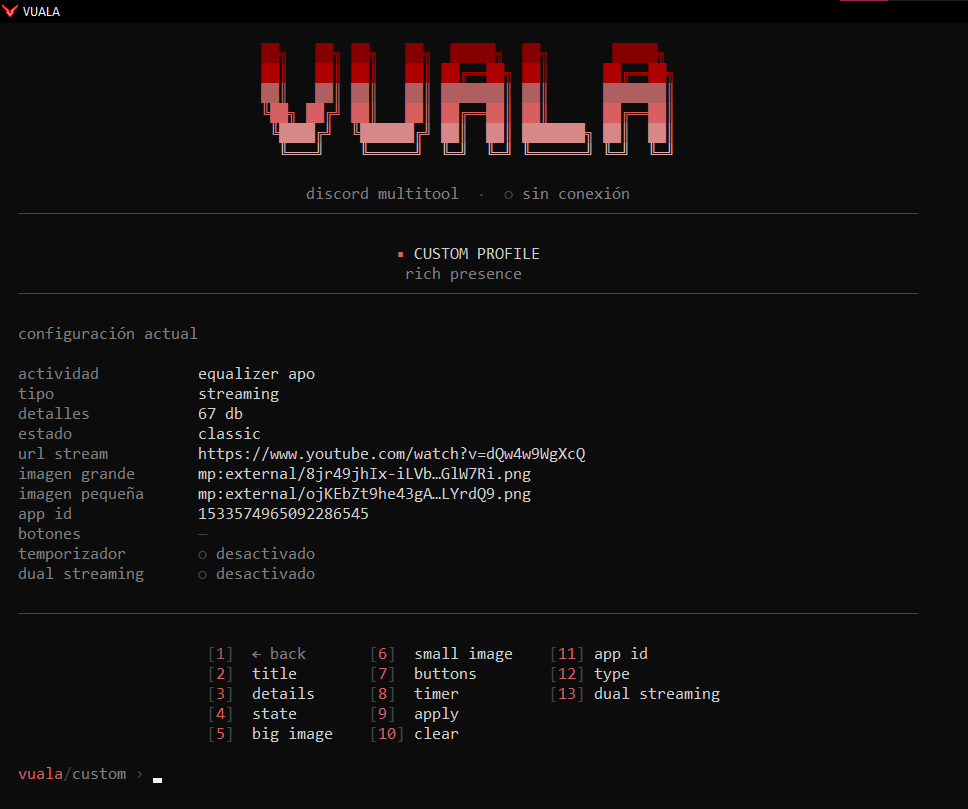
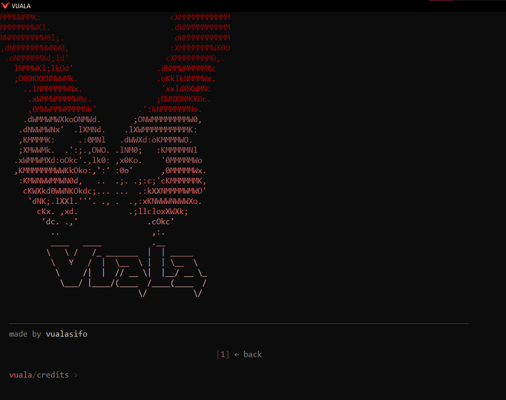

<h1 align="center">VUALA</h1>

<em>discord multitool · minimalista · auto-actualizable</em>

  Para obtener una licencia/key contacta a <b>@vualasifo</b> en Discord.

---

## ¿Qué es?

**VUALA** es un multitool de Discord con una interfaz limpia en consola. Se abre con una **licencia/key** y se **actualiza sola**: al cerrar y volver a abrir, ya tienes la última versión sin descargar nada de nuevo.

## Características

- **Commands** — mute · unmute · ensord · kick vc perma · suspend · name · ban perma · msj · vc · purge · audio bardo
- **Custom profile** — Rich Presence personalizado (imágenes, botones, estados).
- **Licencias** — acceso por key; keys temporales y permanentes.
- **Auto-update** — nuevas versiones al instante de reiniciar.

## Capturas

    
    
    
  

---

made by vualasifo

